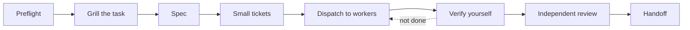

<div align="center">

# 🧭 dispatch-workers

**An agent skill for splitting work across cheap workers, then checking it yourself.**

Plan small tickets · hand them to free or low-cost CLIs first · verify every result · review with a different model · hand off cleanly

[](#install)
[](https://skills.sh/)
[](https://skills.sh/)

</div>

---

## Why

Strong models are expensive and workers can be sloppy. This skill makes the strong model the
**orchestrator**: it understands the problem, writes small tickets, lets cheaper workers do the
typing, and trusts nothing until it has rerun the tests itself.

## The flow



| Step | What happens |
|---|---|
| **Preflight** | `scripts/preflight.sh` checks that the skills it relies on are installed and prints the install line for any that are missing. |
| **Grill** | Task unclear? Interview first (`grill-with-docs`) so tickets are not built on guesses. |
| **Spec, tickets** | `to-spec` then `to-tickets`: one purpose, named files, own test, declared blocking edges. |
| **Dispatch** | Free or cheap worker CLIs first, a mid-tier model next, the strongest model only for design and hard bugs. |
| **Verify** | Check files really changed, rerun build and tests, make sure the tests can fail. Worker reports are claims, not results. |
| **Review** | A different model than the author reviews the diff against the spec. |
| **Handoff** | `handoff` leaves state, open questions and the next ticket for the following session. |

## Install

```bash
npx skills add ptsuriya/dispatch-workers
```

Add `-g` for a user-level install. Then ask your agent to dispatch some work, or invoke the skill by name.

## What it needs

Run the preflight any time:

```bash
bash scripts/preflight.sh
```

| Kind | Items | If missing |
|---|---|---|
| **Required skills** | `caveman` `ponytail` `grilling` `domain-modeling` `grill-with-docs` `to-spec` `to-tickets` `handoff` `code-review` | Stops and prints the `npx skills add` line |
| **Optional skills** | `wayfinder` `implement` `diagnosing-bugs` `tdd` | Listed as absent, work continues |
| **Worker CLIs** | `muse` `codex` `copilot` `opencode` (any subset) | Falls back to the next worker |

It exits `0` when every required skill is present and `1` otherwise.

## Repo layout

```
SKILL.md                  the skill itself
scripts/preflight.sh      dependency check
references/workers.md     how to call worker CLIs, and the traps (empty output, quota, stdin)
```

## Honest limits

- Worker CLI invocations in `references/workers.md` are typical forms. Flags change between versions, so run `--help` once first.
- The preflight only checks that a skill exists on disk, not that it is the version you expect.
- The skill gives the orchestrator rules; it cannot force a worker to follow them. That is why verification is step four.

## License

No license file yet. Add one before expecting others to reuse or modify this.
